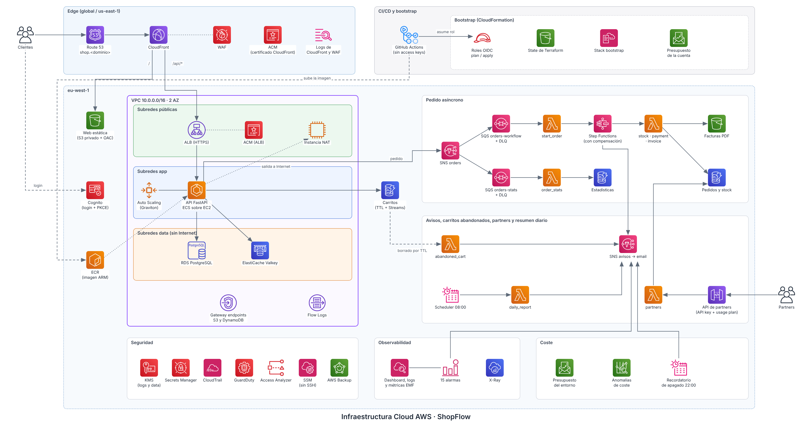
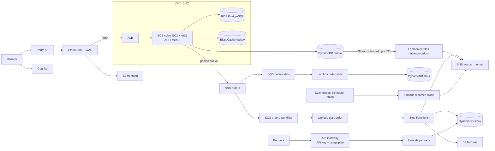
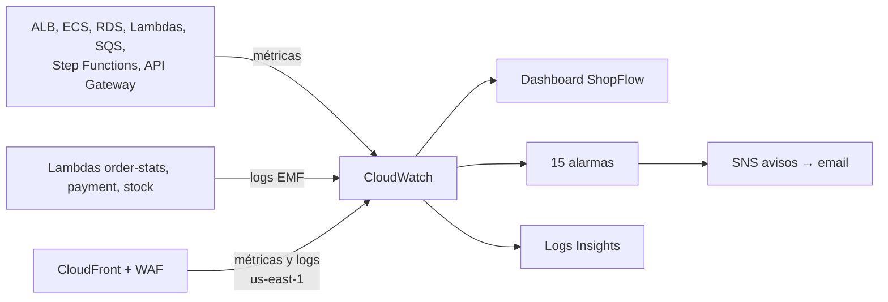
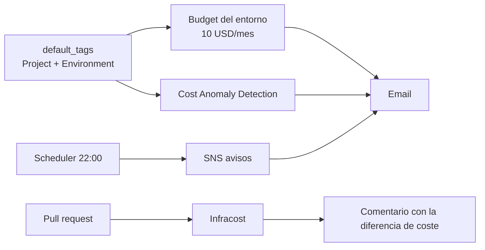

# Arquitectura

Vista general de la aplicación de ejemplo **ShopFlow** sobre la que se monta la infraestructura.

Debajo, el mismo flujo en Mermaid.

Detalle de la red (subredes, rutas, NAT, NACLs): [network.md](network.md).

### Observabilidad

### Coste

## Flujos

| Flujo | Servicios |
|---|---|
| Web | Route 53, ACM, CloudFront, S3 |
| API principal | ALB, ECS en EC2 con Auto Scaling, EBS, ECR |
| Catálogo | RDS PostgreSQL + ElastiCache (Valkey) |
| Carrito | DynamoDB con TTL y Streams |
| Login | Cognito |
| Pedido | SNS → SQS (fan-out a dos colas) → Lambda → Step Functions → DynamoDB / S3 / SNS |
| Carritos abandonados | DynamoDB Streams (solo borrados por TTL) → Lambda → SNS |
| Resumen diario | EventBridge Scheduler → Lambda → SNS |
| API de partners | API Gateway + Lambda con API keys y throttling |
| Observabilidad | CloudWatch (dashboard, alarmas → SNS, métricas EMF, Logs Insights), logs de CloudFront y WAF en us-east-1, X-Ray |
| Coste | Budgets y Cost Anomaly Detection por etiquetas, recordatorio nocturno de apagado, Infracost en los PR |
