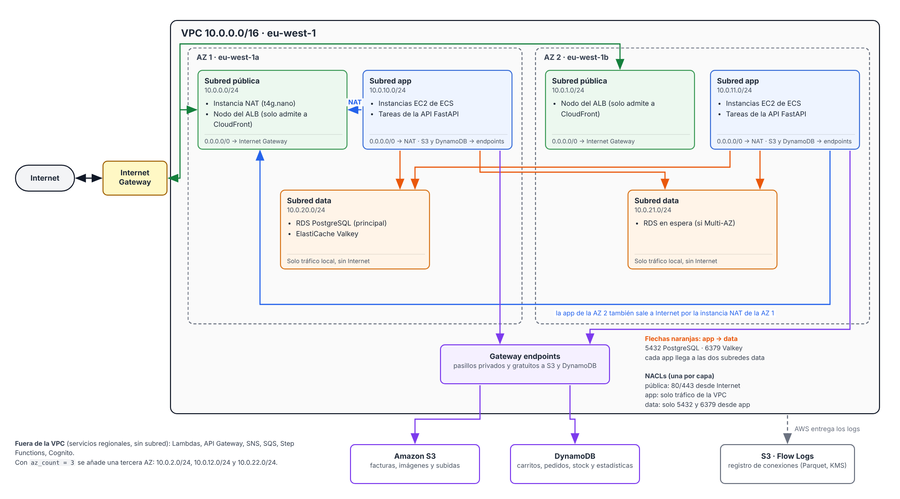

# Red 

VPC `10.0.0.0/16` en `eu-west-1`, 2 zonas de disponibilidad y 3 capas de subredes.
Código en [terraform/modules/network](../terraform/modules/network).

## Subredes

| Capa | AZ a | AZ b | AZ c (si `az_count = 3`) | Salida a Internet | Qué vive aquí |
|---|---|---|---|---|---|
| public | 10.0.0.0/24 | 10.0.1.0/24 | 10.0.2.0/24 | Internet Gateway | ALB, instancia NAT / NAT Gateway |
| app | 10.0.10.0/24 | 10.0.11.0/24 | 10.0.12.0/24 | NAT | Instancias ECS con las tareas de la API |
| data | 10.0.20.0/24 | 10.0.21.0/24 | 10.0.22.0/24 | Ninguna | RDS, ElastiCache |

Ninguna subred asigna IP pública automáticamente.

## Rutas

| Tabla | Rutas |
|---|---|
| `rt-public` | local, `0.0.0.0/0` → Internet Gateway |
| `rt-app-a`, `rt-app-b` | local, `0.0.0.0/0` → NAT, S3 y DynamoDB → gateway endpoints |
| `rt-data` | solo local |

## Salida a Internet (`nat_mode`)

| Modo | Coste aprox. | Alta disponibilidad | Uso |
|---|---|---|---|
| `instance` (por defecto) | ~0,01 USD/h (t4g.nano + IP pública) | No (una instancia) | dev |
| `gateway` | ~0,05 USD/h por NAT Gateway + 0,048 USD/GB | Sí, con `nat_gateway_per_az = true` | prod |
| `none` | 0 | — | Solo endpoints |

## Filtros

- **NACLs** (sin estado, por subred): filtro grueso por capa. `public` admite 80/443 desde Internet, respuestas y todo el tráfico de la VPC; `app` admite la VPC y respuestas;
  `data` solo admite PostgreSQL (5432) y Valkey (6379) desde `app`, y tráfico entre subredes de datos.
- **Security groups** (con estado, por recurso): el filtro fino, encadenado por servicio a partir de las fases 3 y 4.
  El security group por defecto de la VPC queda sin reglas.

## Flow Logs

Todo el tráfico (aceptado y rechazado) de la VPC, agregado cada 10 min, en Parquet con particiones por hora en
`s3://infra-cloud-aws-dev-flow-logs-<cuenta>/AWSLogs/`. Caducan a los 30 días. Consultables con Athena.
